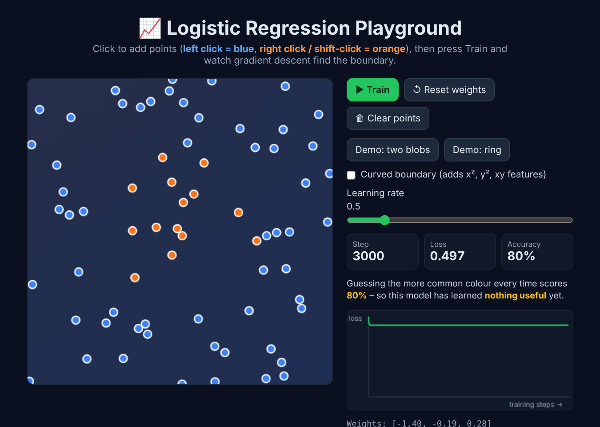
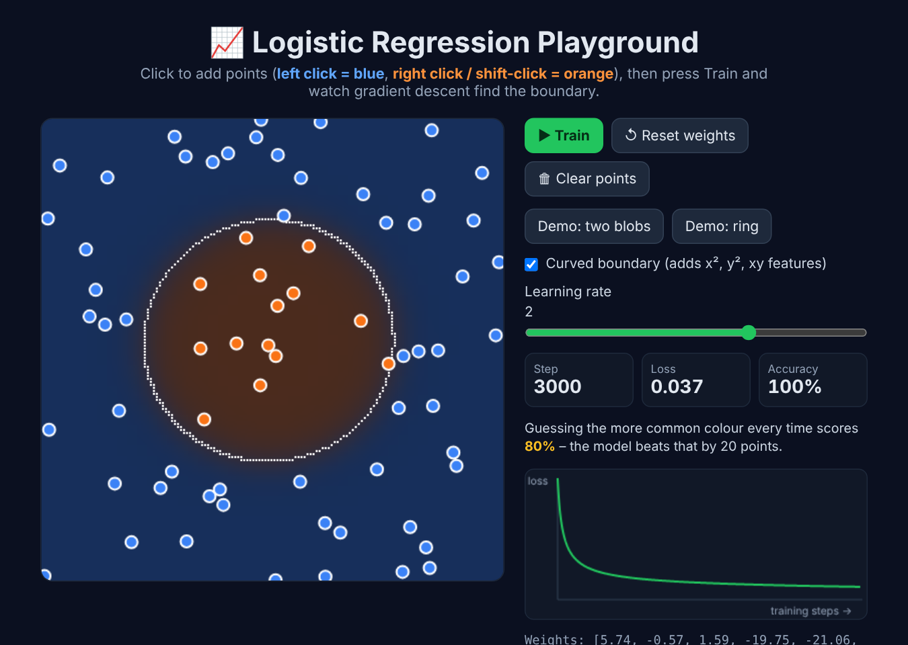
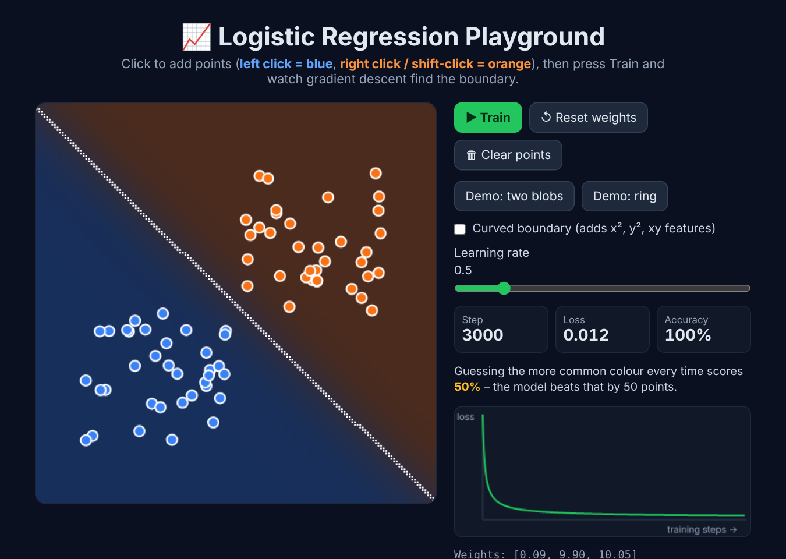

# 📈 Logistic Regression Playground

A small interactive page for watching **logistic regression** learn. Click to place points from two classes, press **Train**, and watch **gradient descent** move the decision boundary step by step, with a live loss curve.
Plain HTML and JavaScript: no libraries, no build step.

| Straight line on a ring: learns nothing | Curved features: solves it |
|---|---|
|  |  |



## Run it
Open `index.html` in your browser. Run the tests with `node test.js`.

## What you can try
- **Left click** adds a blue point, **right click** (or shift-click) adds an orange one, or load a demo.
- **Train / Pause** shows the boundary (white dotted line) and the colour shading (the model's confidence) updating live.
- **Learning rate:** too low and it crawls; very high and it can overshoot.
- **Curved boundary:** adds x², y² and xy features, so the boundary can bend into circles and ellipses.

## Results (from the demos)
| Dataset | Model | Loss | Accuracy | "Always guess the majority" |
|---|---|---|---|---|
| Two blobs | straight line | 0.012 | 100% | 50% |
| Ring | straight line | 0.497 | 80% | **80%** → learned nothing |
| Ring | curved | 0.037 | 100% | 80% |

**The lesson in row 2:** 80% accuracy *sounds* good, but 80% of the ring's points are blue, so "always say blue" scores the same. A straight line can't separate a ring, so the model gives up and does exactly that. Always compare accuracy against a simple baseline. The app shows that baseline under the accuracy.

## How it works
- **Prediction:** `P(orange) = sigmoid(w · features)`, where `sigmoid(z) = 1 / (1 + e^-z)` squashes any number into 0–1.
- **Features:** `[1, x, y]` for a straight line, or `[1, x, y, x², y², xy]` for a curved boundary. The model is still *linear in its weights*; only the inputs changed.
- **Loss:** cross-entropy, `−log P(correct colour)` averaged over the points. It starts at 0.693 (a 50/50 guess).
- **Gradient descent:** `w ← w − learning_rate × average((prediction − label) × features)`, repeated thousands of times.

## Files
```
index.html, style.css   # page layout
model.js                # logistic regression + gradient descent (no DOM)
app.js                  # canvas drawing, clicks, live training, loss curve
test.js                 # 4 tests: learns blobs, loss never rises, curved beats straight on a ring
screenshots/
```

## License
MIT
